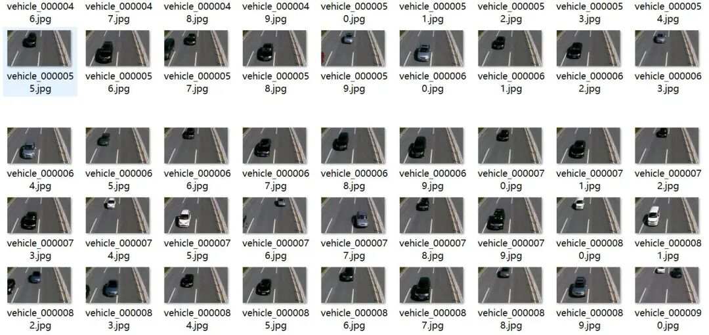
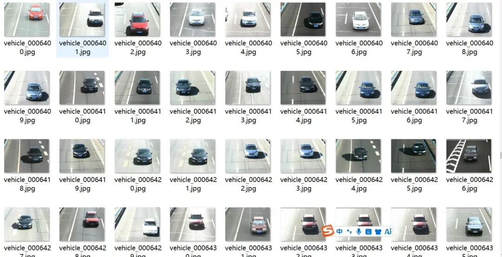
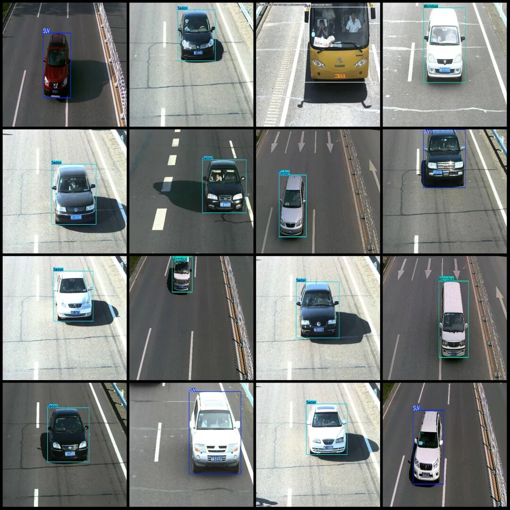
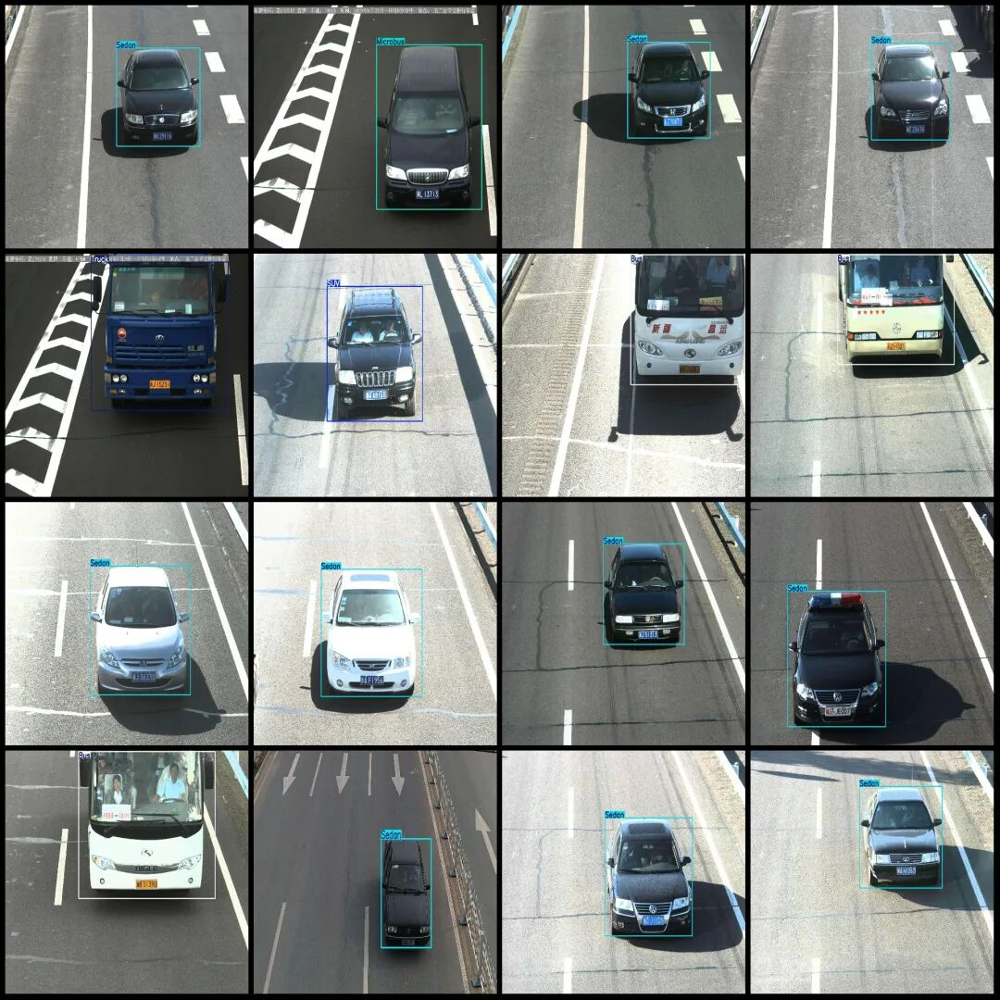

# BIT-Vehicle vehicle detection dataset VOC+YOLO format with 9850 images in 6 categories

Dataset format: Pascal VOC format + YOLO format (txt file without split path, only containing jpg images and corresponding VOC format xml files and yolo format txt files)

Number of images (number of jpg files): 9850

Number of annotations (number of xml files): 9850

Number of annotations (number of txt files): 9850

Label count: 6

Label category names (note that the order of categories in the YOLO format does not correspond to this, but is based on the labels folder's classes.txt): ["Bus", "Microbus", "Minivan", "SUV", "Sedan", "Truck"]

Number of boxes labeled in each category:

Bus (bus) frame count = 558, occupying picture count = 555

Microbus (Bakery/Minivan) frame count = 883, occupying picture count = 878.

Minivan (small van) frame count = 476, occupying picture count = 474

SUV (Sports Utility Vehicle) frame count = 1392, occupying picture count = 1381

Sedan (sedan) frame count = 5921, occupying picture count = 5796

Truck (truck) frame count = 823, occupying picture count = 821

Total frame count: 10053

Image resolution: Multi-resolution images, such as 1600x1200, 1920x1080, etc.

Using labelImg:

Annotation rules: Draw a rectangle around the category.

Important Notice: The dataset does not have separate training, validation, and test sets; you need to partition them yourself.

Special : This dataset does not guarantee the accuracy of the trained models or weight files.

Image Preview:

Annotation example:

## Payment

Here is a pay link on Stripe ( https://buy.stripe.com/3cs8yP7sY87d0vu9AB ). Please contact me lonlonago@foxmail.com after funding $89, and I will send you a complete data files , thank you!

